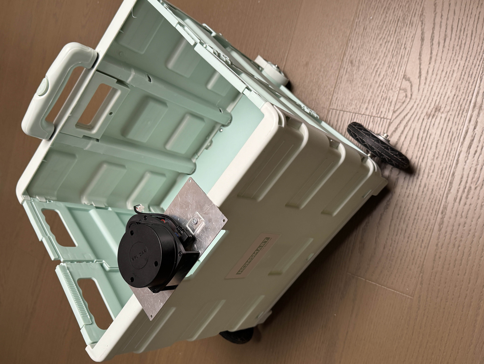
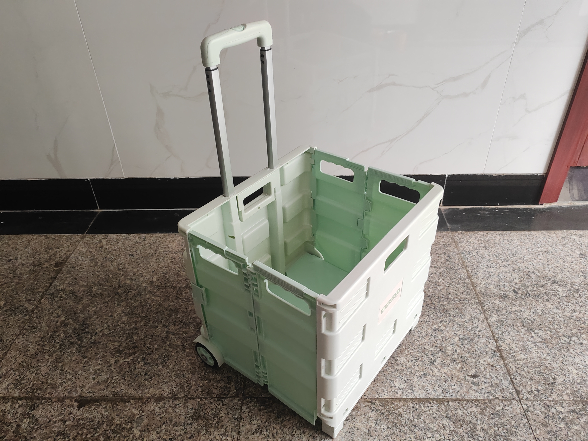
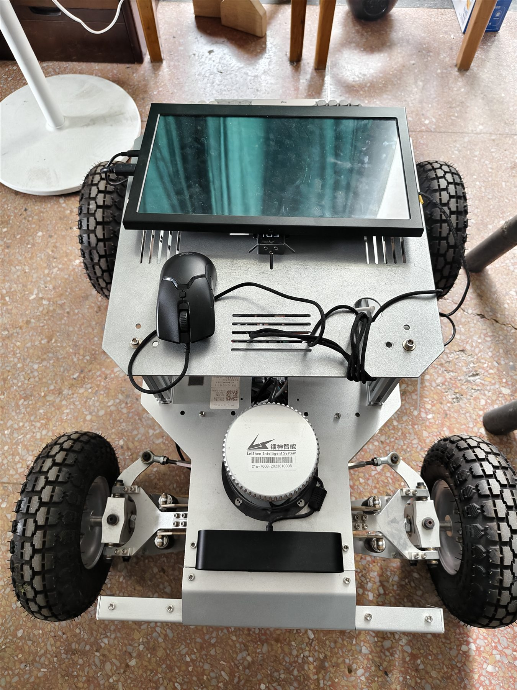
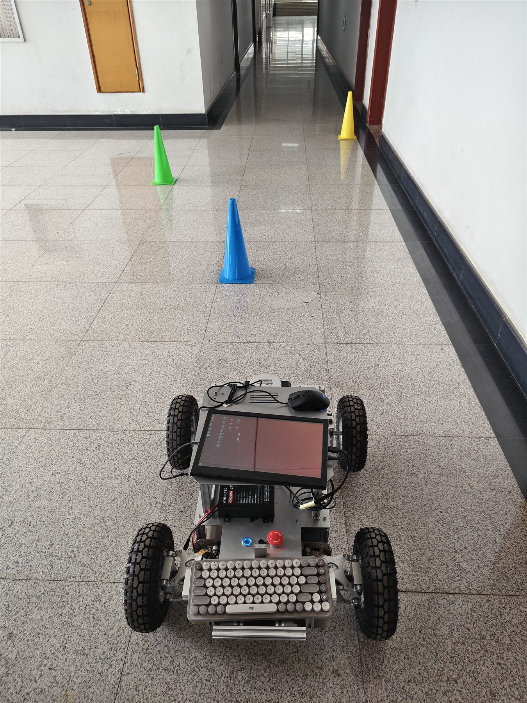
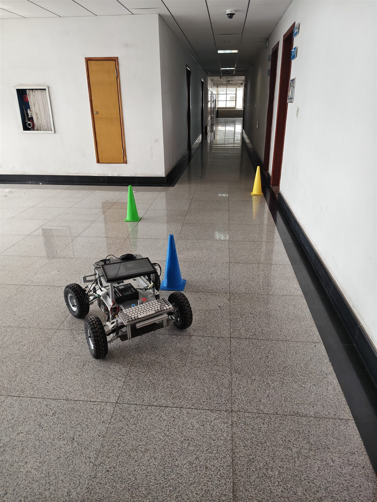
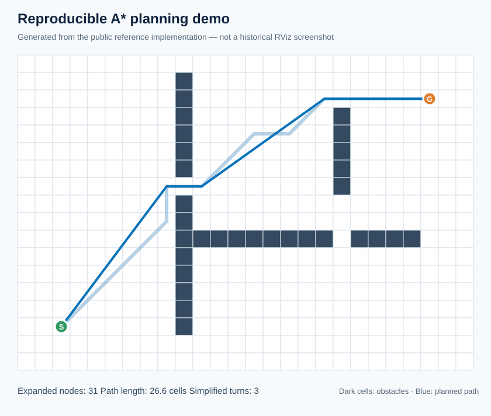
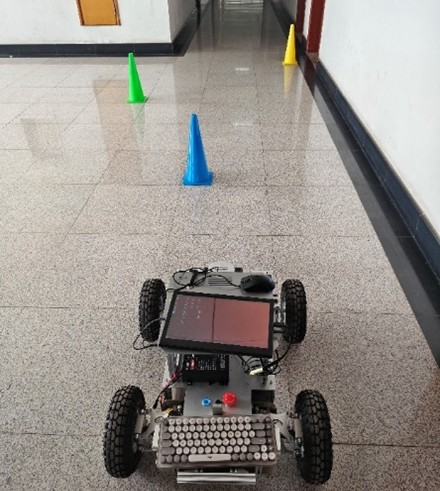
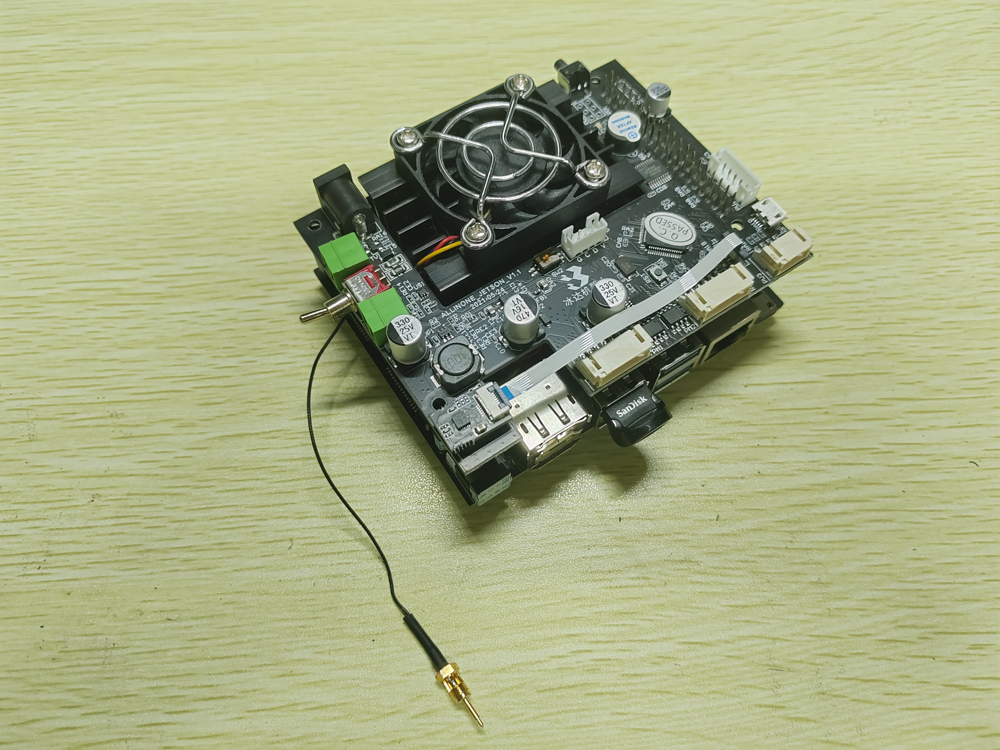
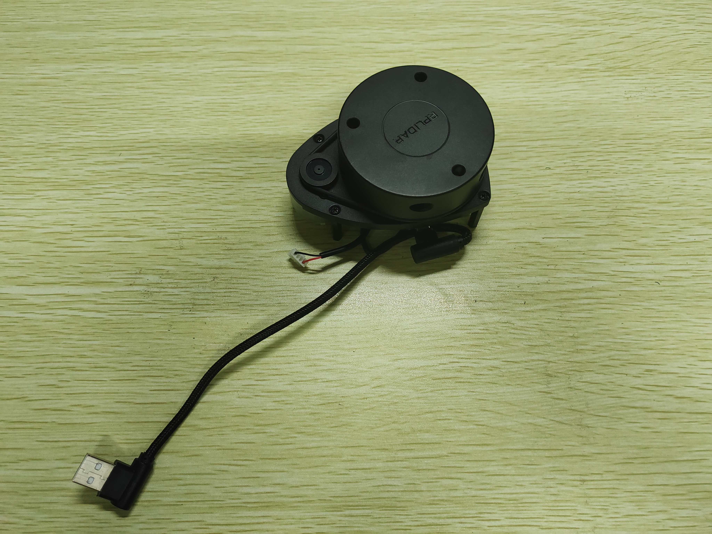

# FollowMe: Multimodal Autonomous Shopping Cart

**An indoor follow-me mobile robot focused on path planning, obstacle avoidance, and differential-drive control.**

[中文](README_CN.md) · [Project facts](docs/PROJECT_FACTS.md) · [Reproducibility](docs/REPRODUCIBILITY.md) · [Sources](docs/SOURCES_AND_ATTRIBUTION.md)

<p align="center">
  
</p>

## Results at a glance

The project had two physical development stages: an exploratory green folding-cart conversion followed by a completed four-wheel mechanical platform. The values below are records from the final project report.

| Evaluation item | Reported result |
|---|---:|
| Mean following distance | 1.59 m |
| Path-tracking error | < 0.15 m |
| Repeat localization error — X | ±0.05 m |
| Repeat localization error — Y | ±0.10 m |
| Repeat heading error | ±5° |
| Dynamic obstacle avoidance | Demonstrated in an indoor corridor |

> The archived folder does not contain the raw trial logs or the number of obstacle-avoidance trials. For that reason, the reported 100% success rate is not used as a headline metric here.

## My contribution

**Role:** Project lead · Path-planning developer · System-integration coordinator

- Designed the grid-based A* global path-planning workflow.
- Implemented eight-neighbor search, obstacle constraints, path reconstruction, and path simplification.
- Participated in the integration of global planning and local obstacle avoidance.
- Coordinated planning and differential-drive chassis-control interfaces.
- Used closed-loop control to track planned paths and coordinated simulation and physical tests.
- Investigated localization drift, trajectory error, control stability, and module communication issues.

## Physical prototype and experiments

### From an integration attempt to a testable platform

| Base cart | Early integration attempt |
|---|---|
|  |  |

The green cart served as the first physical integration platform for drive hardware, LiDAR, and wiring. Experience from this stage informed the completed four-wheel vehicle used for the final planning, control, and obstacle-avoidance experiments.

### Final experimental platform

<p align="center">
  
</p>

The completed system combined a rigid four-wheel chassis, front-mounted 2D LiDAR, onboard computing, and an integrated display and control interface. This platform was used for indoor route execution, trajectory tracking, and obstacle-avoidance validation.

| Corridor experiment layout | Static obstacle-avoidance test |
|---|---|
|  |  |

### Reproducible planning reconstruction

<p align="center">
  
</p>

This figure is generated by [`scripts/render_planning_demo.py`](scripts/render_planning_demo.py) from the public A* reconstruction. It is not presented as historical ROS or RViz output from the physical vehicle.

### Additional corridor test record

<p align="center">
  
</p>

Traffic cones were placed in an indoor corridor to test planning, trajectory tracking, and obstacle avoidance on a physical mobile platform.

### Computing and sensing hardware

| Onboard controller | 2D LiDAR |
|---|---|
|  |  |

## System design

The original proposal organized the intended scope around platform integration, autonomous motion, perception and interaction, and experimental validation. It is retained as planning context—not as proof that every proposed module reached final integration. The verified planning workflow connects four functional stages:

1. **Perception:** LiDAR, visual sensing, and odometry acquire environmental and robot-state information.
2. **Environment representation:** an occupancy grid identifies free and blocked cells for planning.
3. **Planning:** global planning generates a route while local planning reacts to nearby obstacles.
4. **Control:** velocity commands are converted into differential wheel motion for path tracking.

The archived RViz map was taken from proposal material and is intentionally excluded because it was not generated by the project vehicle. Full visual target perception and multimodal fusion also remained incomplete.

## Core planning work

### Global planning

The planner represents the environment as a two-dimensional grid and applies A* search to generate a collision-free route. The project work covered:

- eight-direction neighbor expansion;
- map-boundary and obstacle checks;
- heuristic-guided node selection;
- parent-based path reconstruction;
- removal of redundant turns and safe path shortcutting.

### Local obstacle avoidance

The local planner evaluates short candidate trajectories, rejects collision-prone motion, and balances goal heading, obstacle clearance, forward speed, and consistency with the global route.

### Trajectory control

Position and heading errors are converted into linear and angular velocity commands. Closed-loop control then adjusts the left and right wheel speeds to follow the planned route.

## Reference implementation

The repository includes a compact, testable reconstruction of the planning logic:

- [`astar.py`](src/follow_me_planner/astar.py): baseline and improved grid planning;
- [`dwa.py`](src/follow_me_planner/dwa.py): DWA-style local trajectory evaluation;
- [`tests/`](tests): path-safety and planner regression tests.

```bash
python -m unittest discover -s tests -v
```

This code was reconstructed from the archived project material and the authorized Zhang Xiang thesis reference. It is not presented as the original ROS workspace used for the historical physical experiments.

## Project information

| Item | Description |
|---|---|
| Project | Multimodal Perception Autonomous Follow-Me Shopping Cart for Smart Retail |
| Program | Undergraduate Innovation Training Project, Hefei University of Technology |
| Period | May 2025 – April 2026 |
| Role | Project lead |
| Main responsibility | Path planning, motion control, and system integration |

## Current limitations

- Visual target recognition was not fully integrated with the complete navigation pipeline.
- Tests were conducted mainly in campus indoor and corridor environments rather than a crowded supermarket.
- The original ROS packages, raw experiment logs, ROS bags, firmware, and complete demo video are not present in the archived folder.

No open-source license is granted yet. See [Sources and attribution](docs/SOURCES_AND_ATTRIBUTION.md) for the distinction between historical project evidence, reconstructed code, and reference material.
